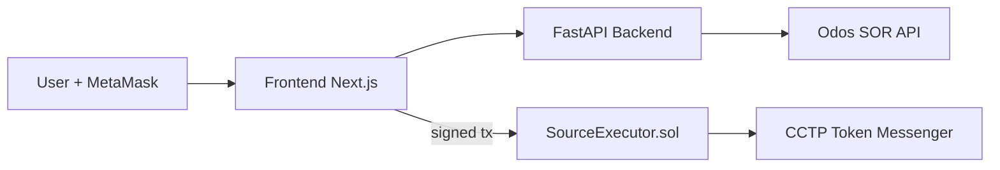

# BridgX Architecture

## 1) System Overview

BridgX is organized as three major layers:

1. **Frontend (Next.js):** user input, wallet connection, quote visualization, status pages.
2. **Backend (FastAPI):** route quoting, provider API integration, price service.
3. **On-chain execution (Solidity):** source transaction execution and cross-domain burn initiation.

## 2) High-Level Data Flow

## 3) Quote Pipeline

For the top-level bridge quote endpoint:

1. Validate source/destination chain names.
2. Resolve per-chain BTC/USDC token addresses and decimals.
3. Convert satoshis to BTC decimal amount.
4. Request provider quote (BTC -> USDC on source).
5. Request provider quote (USDC -> BTC on destination proxy route).
6. Return destination sat estimate with expiry/ETA metadata.

## 4) Chain/Token Resolution Strategy

The backend contains a known-token registry keyed by `(symbol, chain_id)` and can fallback to Avalanche defaults when needed.

Benefits:
- deterministic address/decimal selection,
- low-friction support for chain expansion,
- reduced payload complexity for clients.

## 5) Components and Responsibilities

### Frontend
- Form orchestration and validation.
- MetaMask account access.
- Quote fetch debouncing.
- Route navigation to transfer details pages.
- Mock fallback behavior for missing orchestration endpoints.

### Backend
- Request/response schemas.
- Input sanitization and error normalization.
- External provider calls with timeout control.
- BTC/USD caching strategy.

### Smart Contract
- Pull input token from user.
- Perform swap via router calldata.
- Measure USDC output and enforce non-zero constraint.
- Deposit USDC for burn via token messenger.
- Owner-only rescue capabilities.

## 6) Reliability Considerations

- Provider outages currently surface as 502 responses.
- BTC/USD endpoint includes short cache fallback.
- Frontend can operate in mock mode to keep demo UX resilient.

## 7) Security Considerations

- Contract uses low-level token call wrappers that enforce success behavior.
- Contract rejects unintended native ETH via `NativeValueNotAllowed`.
- Owner-only controls are explicit but require operational key management discipline.
- Backend requires stronger auth/rate-limit layers before production.

## 8) Scalability Path

Near-term scalability improvements:
- Async queue for transfer orchestration.
- Persistent transfer state store.
- Event-driven status updates (SSE/WebSocket).
- Multi-provider quote aggregation and failover.
