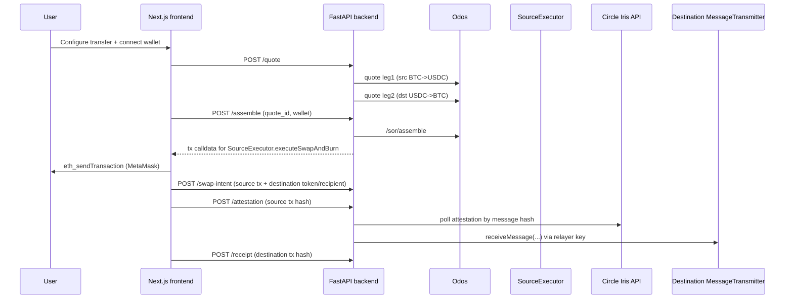

# Architecture (implemented)

## Components

1. **Frontend (`frontend/`)**
   - Next.js App Router client.
   - Main bridge flow is in `app/page.tsx`.
   - Transfer tracking page exists at `app/bridge/[id]/page.tsx` but depends on unimplemented backend `/bridge/*` endpoints and mock fallback behavior.

2. **Backend (`backend/api.py`)**
   - FastAPI service with quote, assemble, swap-intent, attestation, receipt, token, and network endpoints.
   - Uses Odos APIs for route quotes and assembly.
   - Uses chain RPC providers and Circle Iris attestation API for CCTP completion flow.

3. **Contract (`solidity/SourceExecutor.sol`)**
   - Pulls user token, executes Odos calldata, then calls Circle TokenMessenger `depositForBurnWithHook`.

## Runtime flow used by current main UI

## Chain and token model

- Network list exposed by backend: Avalanche, Base, Arbitrum.
- Backend quote path expects BTC-like token symbol + USDC per chain.
- Frontend source-chain selector disables Base and Arbitrum for execution flow.
- Backend `SOURCE_EXECUTOR` mapping includes Avalanche by default; this aligns with current frontend behavior.

## State and persistence

- Quotes are persisted in SQLite (`backend/db/quotes.db` by default) with TTL purge.
- Swap intents are persisted in SQLite (`backend/db/swap_intents.db` by default) and keyed by source tx hash.
- No persistent transfer lifecycle store exists (no `/bridge/*` transfer records).
- No queue/worker component exists; attestation polling happens inside API request scope.

## Reliability boundaries

- API calls depend on live Odos and chain RPC availability.
- `/attestation` depends on relayer key, Circle Iris API responsiveness, and a prior `/swap-intent` write for destination swap/release metadata.
- Frontend non-production mode can mask backend gaps by returning mock responses for some calls.

## Security boundaries visible in code

- Contract has owner-only rescue methods and explicit token call checks.
- Backend has no auth, no rate-limiting, and no request signing.
- Private key for destination `receiveMessage` relay is loaded directly from environment.
